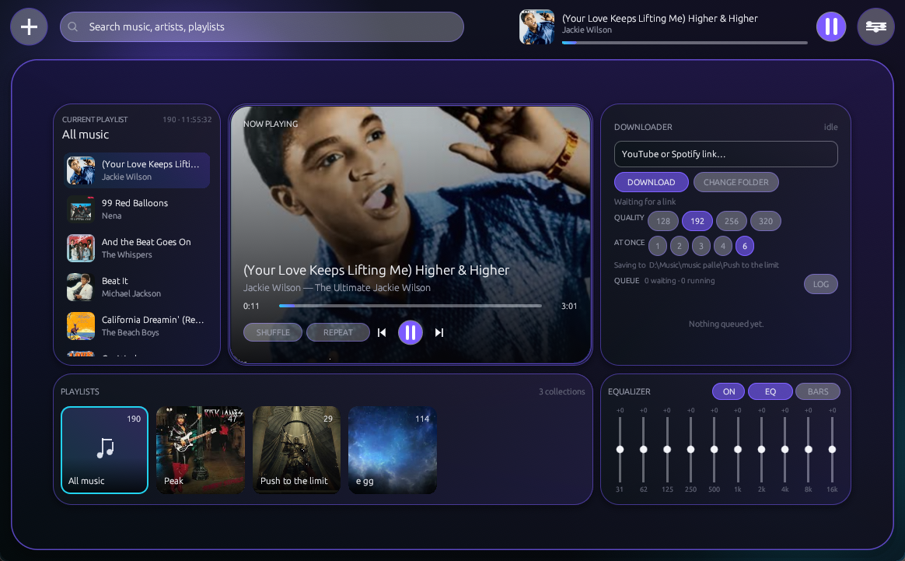

# Def Player

A small desktop music player and playlist downloader written in Rust:
native window (egui/eframe), playback with rodio, tags/cover art with lofty,
downloads through yt-dlp and spotdl.



## The dashboard

The window has a permanent outer frame and a rounded inner dashboard. On top of
the frame sit the add button, search, a compact "now playing" control, play/pause
and the settings button. Inside the dashboard the app is split into five
independent components:

- **Current playlist** — the tracks of the selected playlist (or All music).
- **Player** — the current cover used as a background, title, seek bar and transport.
- **Downloader** — link input, source detection, quality/parallel options and queue.
- **Playlists** — cover cards; click one to filter the current playlist.
- **Equalizer / visualizer** — a real 10-band peaking EQ, or a live spectrum view.

Every panel can be moved and resized. Open **Settings → Layout → Edit layout**
(or press `Ctrl+L`), drag a panel, then pull the bright dot in its bottom-right
corner. Panels snap to each other's edges, to the frame and to an 8 px grid, and
they stay inside a safe area so they never crowd the frame border. Positions and
sizes are stored as proportions of the frame, so the layout follows the window
size. In edit mode a red button in the panel corner hides it; the top-left `+`
changes purpose and lists hidden components so you can add them back. The Layout
tab also has a visibility switch for every component.

The inner dashboard keeps its own dark surface (or your photo); the outer frame
is independently themeable from **Settings → Appearance**:

- the two gradient stops, angle, accent strength, glow and corner radius
- the outer frame colour and opacity (the area nearest the window edge)
- separate inner-frame and component borders, each with a show switch and width;
  component content automatically insets itself as borders get thicker
- an inner background colour plus an optional photo on top of it, with a dim
  slider
- presets (Aurora, Sunset, Ocean, Ember, Mono, Neon, Forest, Royal)

The settings are saved to `config.txt`.

## Liquid Glass

Def Player has an optional Apple-style **Liquid Glass** surface. Toggle it at
**Settings → Appearance → Enable Liquid Glass mode**, then open the **GLASS** tab
for the full material editor. It is a native egui port of the material model from
[liquid-rust](https://github.com/al1h3n/liquid-rust) (MIT OR Apache-2.0): the same
presets, tone fills, size adaptation, iOS 27 transparency slider and accessibility
switches. The app keeps its OpenGL/egui renderer, so frost and refraction are
reproduced with bevel bands and a directional rim light rather than a wgpu
backdrop pass.

### Targets

Each group can be enabled independently:

| Target | Components |
| --- | --- |
| Top bar | `+`, settings, search pill |
| Transport | previous / play-pause / next / mute, including the mini player |
| Player chips | shuffle and repeat |
| Downloader actions | Download, Cancel All, Change Folder, Clear, Log, cancel `×` |
| Option chips | quality, parallel, EQ on/off, EQ/BARS, EQ presets |
| Menus and popups | add menu, search results |
| Lists and cards | track rows, playlist cover rings, download queue rows, search rows |
| Slider balls only | seek, volume and EQ knobs (the track stays flat) |
| Panels and modals | the five dashboard panels, settings card, preview card |
| Settings controls | settings tabs, action pills, toggles, colour presets |
| Setup screen | Choose folder, Use default, Start using Def Player |

Defaults: transport, player chips, downloader actions, menus, lists, slider balls
and panels are on; the rest are off.

### Material

| Setting | Range | What it does |
| --- | --- | --- |
| Refraction | 0–1 | strength of the bevel bands |
| Depth | 0–80 pt | how far the bevel reaches inward |
| Dispersion | 0–1 | chromatic split along the bevel |
| Frost | 0–60 pt | white frost veil / blur weight |
| Splay | 0–1 | how widely the rim light spreads |
| Specular | 0–1 | strength of the lit rim |
| Rim | 0–1 | bright inner edge |
| Rim shade | 0–1 | soft shade opposite the light |
| Hairline | 0–1 | crisp 1.25 pt chrome line |
| Edge | 0–1 | darkened outer line |
| Dim | 0–1 | local backdrop dimming |
| Adaptive | on/off | large glass becomes thicker and more opaque |
| Tint | on/off + colour + strength | stained-glass colour |
| Shadow offset Y / blur / opacity | −30–40 pt / 0–100 pt / 0–1 | drop shadow |

### Light face and dark face tones

Both faces expose liquid-rust's six tone operations. They run in sRGB space in
this order:

| Setting | Range | Operation |
| --- | --- | --- |
| Lift | 0–0.5 | `LINEAR_DODGE` grey |
| Luminance target | 0–1 | target of the `LUMINOSITY` fill |
| Luminance mix | 0–1 | opacity of that fill |
| Lighten | 0–1 | white `LIGHTEN` fill |
| Darken to | 0–1 | grey used by the `DARKEN` fill |
| Darken | 0–1 | opacity of that fill |

### Appearance and scene

| Setting | What it does |
| --- | --- |
| Dark colour scheme | choose the dark or light face for large glass |
| Transparency | iOS 27 slider: 0 ultra clear, 0.5 default, 1 fully tinted |
| Reduce Transparency | frostier, more opaque glass with tinted faces |
| Increase Contrast | stronger outer edge and a contrasting border |
| Reduce Motion | disables press/hover motion |
| Adapt to content | small glass may flip light/dark with the backdrop |
| Physics | hover/press motion on or off |
| Glass on glass | enables the extra panel specular pass |
| Light angle | 0° = top, clockwise; drives rim and highlight direction |
| Merge distance | reserved for grouped glass (exposed for parity with liquid-rust) |

### Shape

| Setting | What it does |
| --- | --- |
| Button outline | Capsule, Rounded, Circular or Smooth |
| Shape radius | corner radius for Rounded / Smooth |
| Smoothing | 0 = circular, 0.6 = iOS squircle |

Panels and modals always use the **Corner radius** from the Appearance tab.
Presets **Regular**, **Clear**, **Clear Bar**, **Tinted** and **Identity** reset
only the material values; targets, appearance, shape and scene are kept.

All glass values are stored in `config.txt` under keys beginning with
`ui_glass_` (for example `ui_glass_transparency`, `ui_glass_tint_color`,
`ui_glass_target_transport`).

## What it does

- **First-run setup** — you choose the main music folder before anything else happens.
  That folder is where all downloads go and where the library is scanned from.
- **Library** — add single files or whole folders (recursive scan), or drag & drop onto the window.
- **Playlists** — every subfolder of your main folder is a playlist, shown as a cover card
  with its own artwork and track count. Click one to filter the library; the player and
  current-playlist panel switch to it. Playlists downloaded from YouTube get their cover
  saved as `cover.jpg`.
- **Playlist** — click a row to play, click the active row to pause; the playing row is
  highlighted and scrolled into view. Next/previous follow the playlist you are viewing.
- **Covers** — embedded artwork is read from tags (including artwork that yt-dlp/spotdl
  embed after downloading). Images are centre-cropped to fill the box without stretching;
  tracks without artwork get a drawn placeholder cover.
- **Downloads** — paste a YouTube or Spotify playlist / album / track link. Playlists are
  expanded into one job per track and downloaded several at a time, each with its own
  progress bar. Bitrate (128/192/256/320 kbps) and the number of parallel downloads are
  chosen in the app and remembered.
- **Controls** — play/pause, previous/next, seek bar, volume + mute, shuffle and repeat
  (off / all / one).

## Where files are saved

Everything lives under the **main folder** you pick on first run (default
`C:\Users\<you>\Music\Def Player`):

```
<main folder>\
    Some Song.mp3                     ← single tracks / videos ("All music")
    Popular Music Videos\             ← one subfolder per playlist = one playlist in the app
        cover.jpg                     ← playlist cover (downloaded automatically)
        Track 1.mp3
        Track 2.mp3
```

The subfolder is automatic: playlists, albums and channels are grouped by their own name,
so downloads never mix together. Single tracks are saved straight into the main folder.

The app treats **every subfolder as a playlist**, so folders you create yourself (or files
you move into one) appear in the Playlists panel too. Files sitting directly in the main
folder are listed under **All music**. A playlist's cover is `cover.jpg` / `cover.png` / `folder.jpg`
if present, otherwise the first track's artwork is used.

Change the main folder at any time with **Settings → Library → Change folder** (or the
downloader panel's **Change folder** button). The choice is stored in
`%APPDATA%\DefPlayer\config.txt`:

```
library_root=D:\My Music
quality=192
parallel=3
ui_accent_a=#7C5CFF
ui_accent_b=#22D3EE
ui_angle=132
layout.player=0.23267,0.04702,0.43471,0.58934,1
eq_enabled=1
eq_gains=0,0,0,0,0,0,0,0,0,0
```

The `ui_*`, `layout.*`, `eq_*` and `volume` keys are managed by the settings
window and layout editor; you normally do not need to edit them by hand.

## Download speed and quality

- **Parallel downloads** — `AT ONCE` sets how many tracks run simultaneously (1–6).
  A YouTube playlist is first expanded into individual tracks, then they download
  concurrently; each track has its own progress bar, percentage and stage
  (`Converting to MP3…`, `Embedding cover…`).
- **Quality** — `QUALITY` picks the MP3 bitrate: 128, 192, 256 or 320 kbps. Single
  fragments are also fetched in parallel (`--concurrent-fragments 4`).
- **Cover art** — YouTube thumbnails are downscaled to 640 px JPEG (quality 6) before
  being embedded, so files no longer carry a full-resolution cover.
- **Playlist cover** — the playlist's own artwork is saved (resized to 640 px, ~30 KB) as
  `<playlist>\cover.jpg`; playlists without custom art fall back to the first track's
  thumbnail. The playlist name is shown in the Playlists panel and the player.
- Closing the window stops all running downloads (the whole process tree is killed).

## Keyboard

| Key | Action |
| --- | --- |
| `Space` | play / pause |
| `←` / `→` | seek −5 s / +5 s |
| `↑` / `↓` | volume up / down |
| `M` | mute |
| `Ctrl+F` | search music and playlists |
| `Ctrl+L` | toggle layout mode |
| `Ctrl+,` | open / close settings |

## Run

```powershell
cargo run --release                  # first run asks for your music folder
cargo run --release -- "C:\Music"    # scan an extra folder at startup
cargo run --release -- "C:\Music" --play
cargo run --release -- --downloads             # focus the downloader panel
cargo run --release -- --download "https://www.youtube.com/playlist?list=..."
```

The built binary is `target\release\def_player.exe` (a copy is in the project root as
`Def Player.exe`).

## Downloads: what is needed

The downloader needs these tools in a `bin` folder next to the exe (they are **not** in this
repository — some are larger than GitHub's file size limit):

| Tool | Used for |
| --- | --- |
| `yt-dlp.exe` | YouTube (and most other sites) playlists, albums, videos |
| `spotdl.exe` | Spotify playlists / albums / tracks (finds matching audio, saves MP3) |
| `ffmpeg.exe` + `ffprobe.exe` | audio extraction, MP3 encoding, embedding cover art |
| `av*.dll`, `sw*.dll` | shared libraries required by shared-build ffmpeg (e.g. `avcodec-63.dll`) |

Put them in `bin\` next to `Def Player.exe`:

```
Def Player.exe
bin\
    yt-dlp.exe
    spotdl.exe
    ffmpeg.exe
    ffprobe.exe
    avcodec-63.dll ...
```

The app looks for the tools in `bin` next to the executable, then in the working directory,
then on `PATH`. The player itself works without `bin`; only the downloader panel needs it.

Only download content you have the rights to; you are responsible for respecting the
terms of service of the sites you use.

## Layout

| File | Purpose |
| --- | --- |
| `src/main.rs` | window setup, command line arguments |
| `src/app.rs` | application state and all UI drawing |
| `src/audio.rs` | rodio playback engine, live 10-band EQ and visualizer tap |
| `src/library.rs` | folder scanning, tag + cover extraction |
| `src/download.rs` | yt-dlp / spotdl process handling, progress parsing |
| `src/queue.rs` | parallel download queue, per-job progress and cancellation |
| `src/config.rs` | folder, quality, theme, dashboard layout and EQ settings (`%APPDATA%\DefPlayer\config.txt`) |
| `src/theme.rs` | gradient/glass painting helpers and colour mixing |
| `src/glass.rs` | liquid-glass material resolution, squircle geometry and painting |
| `src/ui.rs` | custom-painted widgets and glyphs |
| `src/visualizer.rs` | small FFT used by the spectrum view |

## Notes / next steps

- The library is rebuilt from your main folder (plus anything you add) each session.
- Playlists are the subfolders of the main folder; there are no separately named playlists inside the app.
- Supported decoders: mp3, flac, wav, ogg/vorbis by default, plus m4a/aac enabled in
  `Cargo.toml`.
