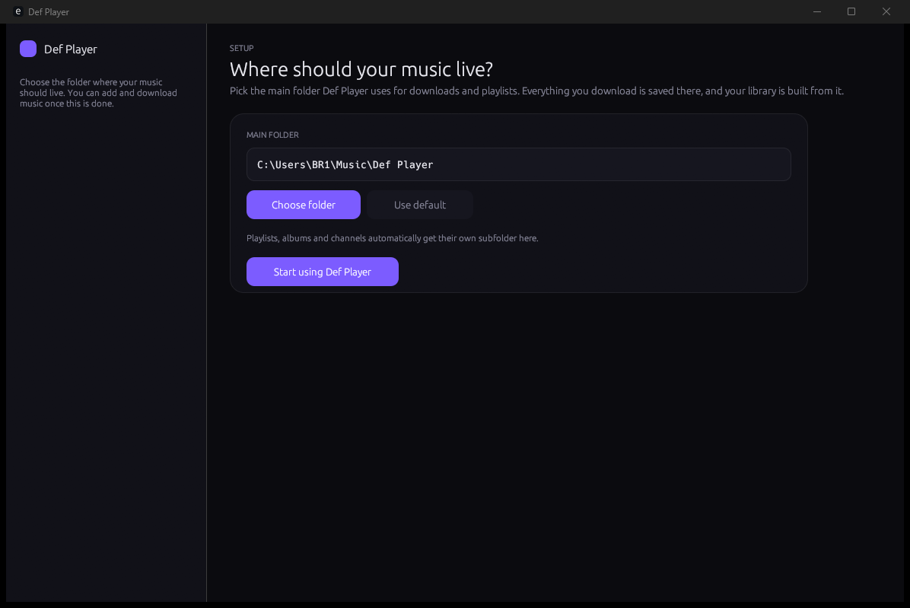
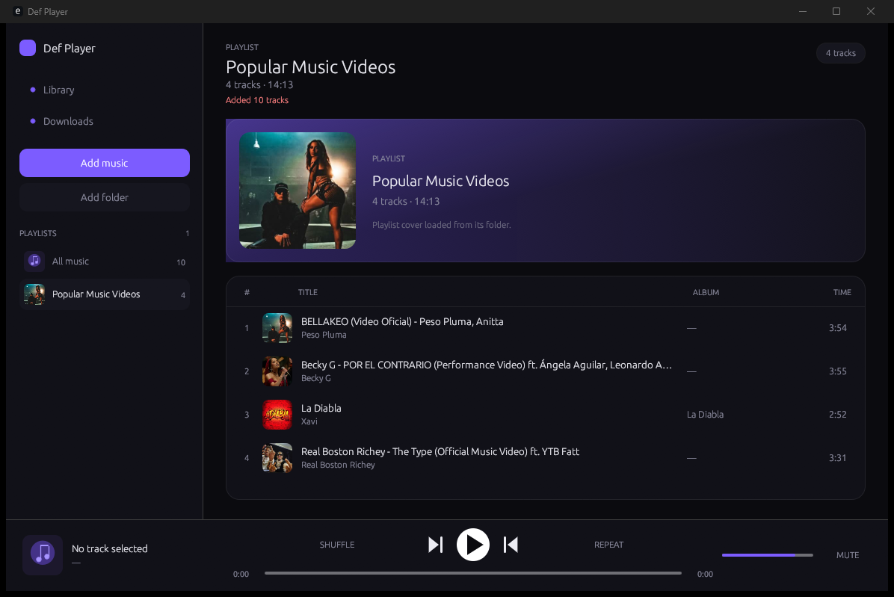
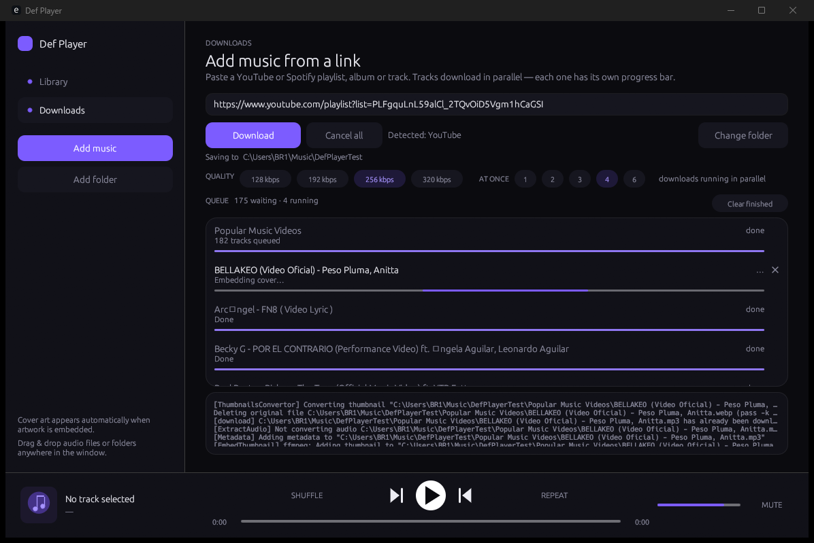

# Def Player

A small desktop music player and playlist downloader written in Rust:
native window (egui/eframe), playback with rodio, tags/cover art with lofty,
downloads through yt-dlp and spotdl.





## What it does

- **First-run setup** — you choose the main music folder before anything else happens.
  That folder is where all downloads go and where the library is scanned from.
- **Library** — add single files or whole folders (recursive scan), or drag & drop onto the window.
- **Playlists** — every subfolder of your main folder is a playlist, shown in the sidebar
  with its own cover and track count. Click one to filter the library; the header and hero
  switch to it. Playlists downloaded from YouTube get their cover saved as `cover.jpg`.
- **Playlist** — click a row to play, click the active row to pause; the playing row is
  highlighted and scrolled into view. Next/previous follow the playlist you are viewing.
- **Covers** — embedded artwork is read from tags (including artwork that yt-dlp/spotdl
  embed after downloading). Images are centre-cropped to fill the box without stretching;
  tracks without artwork get a drawn placeholder cover.
- **Downloads** — paste a YouTube or Spotify playlist / album / track link. Playlists are
  expanded into one job per track and downloaded several at a time, each with its own
  progress bar. Bitrate (128/192/256/320 kbps) and the number of parallel downloads are
  chosen in the app and remembered.
- **Controls** — play/pause, previous/next, seek bar, volume + mute, shuffle and repeat
  (off / all / one).

## Where files are saved

Everything lives under the **main folder** you pick on first run (default
`C:\Users\<you>\Music\Def Player`):

```
<main folder>\
    Some Song.mp3                     ← single tracks / videos ("All music")
    Popular Music Videos\             ← one subfolder per playlist = one playlist in the app
        cover.jpg                     ← playlist cover (downloaded automatically)
        Track 1.mp3
        Track 2.mp3
```

The subfolder is automatic: playlists, albums and channels are grouped by their own name,
so downloads never mix together. Single tracks are saved straight into the main folder.

The app treats **every subfolder as a playlist**, so folders you create yourself (or files
you move into one) appear in the sidebar too. Files sitting directly in the main folder are
listed under **All music**. A playlist's cover is `cover.jpg` / `cover.png` / `folder.jpg`
if present, otherwise the first track's artwork is used.

Change the main folder at any time with **Downloads → Change folder**. The choice is stored in
`%APPDATA%\DefPlayer\config.txt`:

```
library_root=D:\My Music
quality=192
parallel=3
```

## Download speed and quality

- **Parallel downloads** — `AT ONCE` sets how many tracks run simultaneously (1–6).
  A YouTube playlist is first expanded into individual tracks, then they download
  concurrently; each track has its own progress bar, percentage and stage
  (`Converting to MP3…`, `Embedding cover…`).
- **Quality** — `QUALITY` picks the MP3 bitrate: 128, 192, 256 or 320 kbps. Single
  fragments are also fetched in parallel (`--concurrent-fragments 4`).
- **Cover art** — YouTube thumbnails are downscaled to 640 px JPEG (quality 6) before
  being embedded, so files no longer carry a full-resolution cover.
- **Playlist cover** — the playlist's own artwork is saved (resized to 640 px, ~30 KB) as
  `<playlist>\cover.jpg`; playlists without custom art fall back to the first track's
  thumbnail. The playlist name is shown in the sidebar and header.
- Closing the window stops all running downloads (the whole process tree is killed).

## Keyboard

| Key | Action |
| --- | --- |
| `Space` | play / pause |
| `←` / `→` | seek −5 s / +5 s |
| `↑` / `↓` | volume up / down |
| `M` | mute |

## Run

```powershell
cargo run --release                  # first run asks for your music folder
cargo run --release -- "C:\Music"    # scan an extra folder at startup
cargo run --release -- "C:\Music" --play
cargo run --release -- --downloads             # open the download page
cargo run --release -- --download "https://www.youtube.com/playlist?list=..."
```

The built binary is `target\release\def_player.exe` (a copy is in the project root as
`Def Player.exe`).

## Downloads: what is needed

The downloader needs these tools in a `bin` folder next to the exe (they are **not** in this
repository — some are larger than GitHub's file size limit):

| Tool | Used for |
| --- | --- |
| `yt-dlp.exe` | YouTube (and most other sites) playlists, albums, videos |
| `spotdl.exe` | Spotify playlists / albums / tracks (finds matching audio, saves MP3) |
| `ffmpeg.exe` + `ffprobe.exe` | audio extraction, MP3 encoding, embedding cover art |
| `av*.dll`, `sw*.dll` | shared libraries required by shared-build ffmpeg (e.g. `avcodec-63.dll`) |

Put them in `bin\` next to `Def Player.exe`:

```
Def Player.exe
bin\
    yt-dlp.exe
    spotdl.exe
    ffmpeg.exe
    ffprobe.exe
    avcodec-63.dll ...
```

The app looks for the tools in `bin` next to the executable, then in the working directory,
then on `PATH`. The player itself works without `bin`; only the download page needs it.

Only download content you have the rights to; you are responsible for respecting the
terms of service of the sites you use.

## Layout

| File | Purpose |
| --- | --- |
| `src/main.rs` | window setup, command line arguments |
| `src/app.rs` | application state and all UI drawing |
| `src/audio.rs` | rodio playback engine (one sink, one track) |
| `src/library.rs` | folder scanning, tag + cover extraction |
| `src/download.rs` | yt-dlp / spotdl process handling, progress parsing |
| `src/queue.rs` | parallel download queue, per-job progress and cancellation |
| `src/config.rs` | main folder + quality settings (`%APPDATA%\DefPlayer\config.txt`) |
| `src/ui.rs` | palette and custom-painted widgets |

## Notes / next steps

- The library is rebuilt from your main folder (plus anything you add) each session.
- Named playlists inside the app are not implemented — the library is one flat list.
- Supported decoders: mp3, flac, wav, ogg/vorbis by default, plus m4a/aac enabled in
  `Cargo.toml`.
