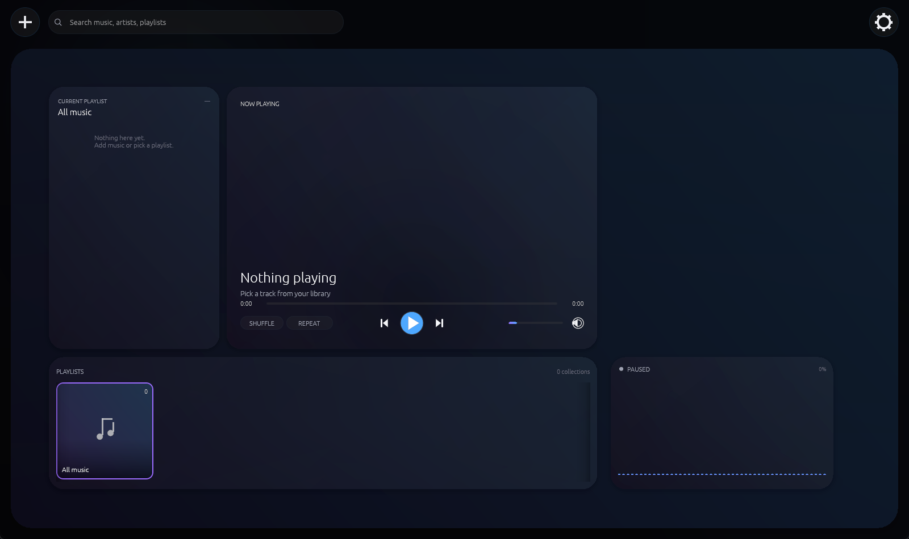
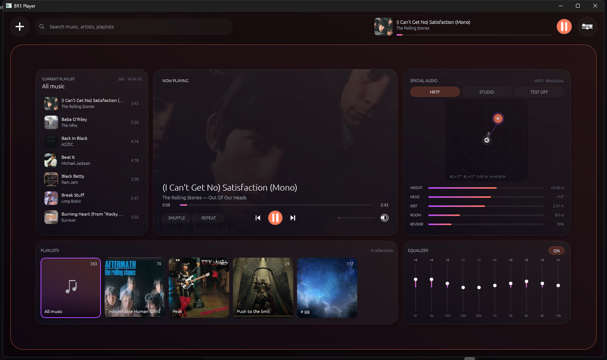
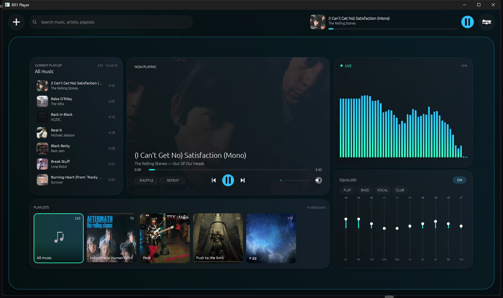
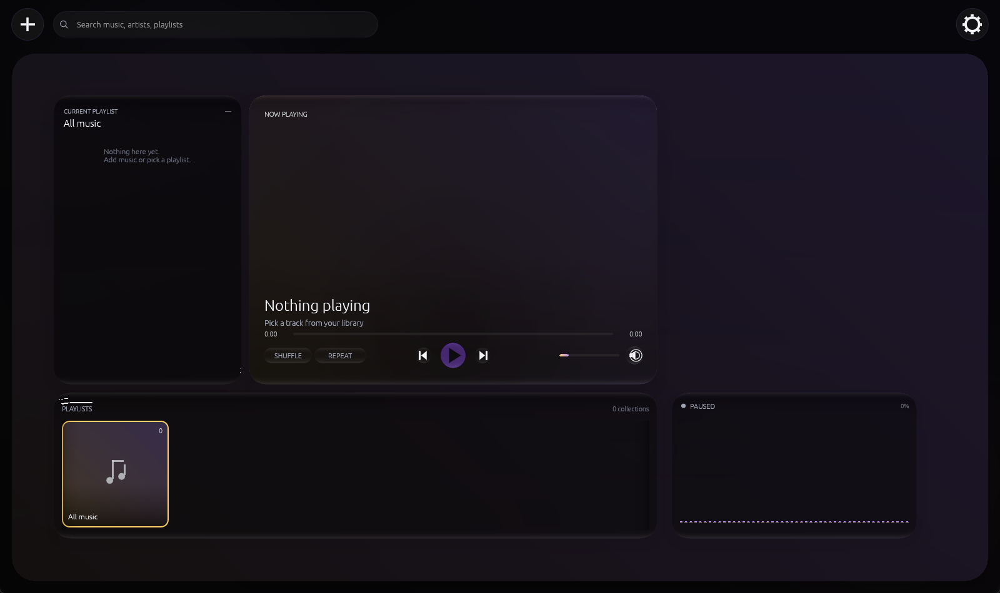
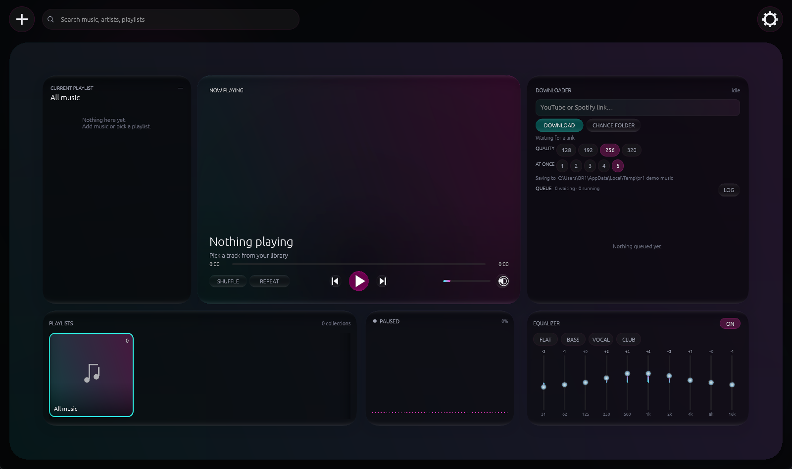
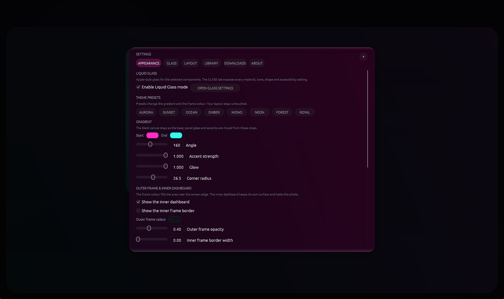

# BR1 Player

A polished desktop music player for Windows with playlist downloads, a real
10-band equalizer, a live visualizer and true binaural spatial audio.

## What it is

BR1 Player is a local-first music player. Keep your music in folders, build
playlists from those folders, or download playlists from YouTube and Spotify.
It is a portable Windows app with no account, no cloud library and no installer.

## What you can do

- **Play your library** — scan a music folder, browse playlists and covers, and
  play MP3, FLAC, WAV, OGG and M4A/AAC files.
- **Download music** — paste a YouTube or Spotify playlist link and let BR1
  Player download, convert and tag the tracks. Choose the MP3 quality, run
  several downloads at once, and watch per-track progress.
- **Shape the sound** — a real 10-band equalizer with Flat, Bass, Vocal and Club
  presets.
- **See the music** — a live spectrum visualizer that reacts to the track.
- **Listen in 3D** — true binaural spatial audio for headphones. Front, back,
  above and below sound like different directions, not just left/right volume.
  Move the sound around, set its distance and height, turn the listener's head,
  choose built-in or measured head-related profiles, compare with normal stereo
  panning, and use the built-in listening tests. The ON/OFF chip in its header
  switches the whole renderer; while it is off — or while the component is not on
  the dashboard — playback stays untouched stereo.
- **Make it yours** — eight theme presets, a custom gradient and frame, your own
  photo or looping video background, optional Liquid Glass surfaces, and
  draggable/resizable dashboard panels. Add, remove and arrange the components
  from the `+` menu.
- **Keep it local** — your music, settings and playback stay on your computer.
  No account and no cloud library.

## Screenshots

### Aurora — main dashboard

### Sunset — spatial audio

### Ocean — visualizer and equalizer

### Royal — main dashboard

### Neon — main dashboard

### Neon — appearance settings

## Getting started

1. Download the latest release from the **Releases** page.
2. Unzip the folder and run `BR1 Player.exe` on Windows 10 or 11 (64-bit).
3. On the first start, BR1 Player automatically downloads its music tools and
   two measured KEMAR headphone profiles. There is nothing to install by hand,
   and this setup only happens once. Later starts use what is already there.

If a first-run download is interrupted, open **Settings → Downloads →
Download missing files** and it will fetch only what is missing.

## Good to know

- The player works offline; an internet connection is only needed for downloads
  and the first-run setup.
- Downloads are saved under your chosen music folder. Playlist downloads get
  their own subfolder and cover.
- Only download music you have the rights to. You are responsible for following
  the terms of service of the sites you use.

## License

MIT — see [LICENSE](LICENSE).

Third-party components and downloaded assets keep their own licenses. The KEMAR
headphone data is downloaded from its public database and is credited in the
`ATTRIBUTION.txt` file next to the downloaded profiles.
